<div align="center">

# Depth-Aware Prosthetic Vision

**Real-time simulation of prosthetic (phosphene) vision fusing iPhone LiDAR depth, YOLO11 semantic segmentation and a biologically-inspired epiretinal implant renderer.**

[](https://www.python.org/)
[](https://opencv.org/)
[](https://pytorch.org/)
[](https://docs.ultralytics.com/)
[](LICENSE)

*Bionic Senses course project · Scuola Superiore Sant'Anna & University of Pisa · M.Sc. Neural Engineering*

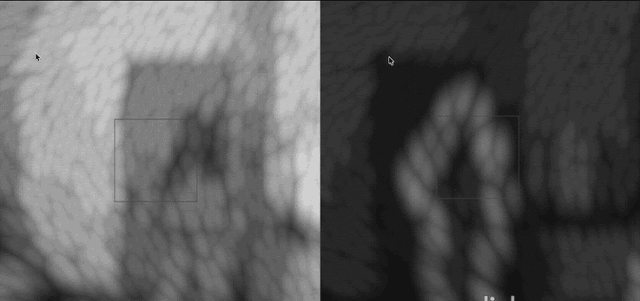

<sub>32×32 simulated phosphene vision of a moving person: <b>RGB-only</b> baseline (left) vs the proposed <b>depth-aware hybrid</b> pipeline (right).</sub>

</div>

---

## Overview

Retinal prostheses restore a rudimentary form of sight by stimulating the retina with an electrode array: patients perceive a sparse grid of light spots called **phosphenes**. With only ~1,000 pixels (32×32) of information, *what* we choose to show matters more than *how much*.

This project is a **Simulated Prosthetic Vision (SPV)** testbed that lets sighted people experience and evaluate that percept in real time. Instead of naively downsampling the camera image, it builds a **depth-aware saliency map**:

- **3D structure** from the iPhone LiDAR / TrueDepth sensor highlights obstacle edges and makes closer objects brighter;
- **Semantics** from YOLO11 segmentation lets the user select a target (cup, bottle, person, ...) that pulses inside the phosphene field;
- **Biological realism** in the renderer (axonal streaks, electrode dropout, blooming, temporal adaptation) approximates what implant users report.

The pipeline was validated with a **user study on 89 participants**: the proposed hybrid mode was preferred by **79.8%** of users for tracking moving subjects.

## Key Features

| | |
|---|---|
| 🛰️ **LiDAR + RGB fusion** | Live RGB-D streaming from an iPhone (Record3D, USB), with sensor-specific edge extraction for rear LiDAR (1–5 m) and FaceID TrueDepth (< 1.2 m). |
| 🎯 **Semantic targeting** | YOLO11-seg running in a background thread; the selected object gets a mask-precise pulsating "internal glow". |
| 👁️ **Phosphene renderer v4** | 32×32 jittered hexagonal array, axon-map streaks oriented towards the optic disc, 10% electrode dropout, blooming, temporal decay, LUT-optimized. |
| 🔭 **Dynamic focus** | Auto-range on the median depth of a central ROI, so brightness adapts to where the user is looking. |
| 🔊 **Audio feedback** | Distance-dependent beeps for the selected target. |
| 🎙️ **Voice control** | Offline "Jarvis" wake word (Vosk) to switch targets and toggle features hands-free. |
| 💻 **Hardware fallback** | Runs on any webcam with simulated depth when no iPhone is connected. |

## Pipeline

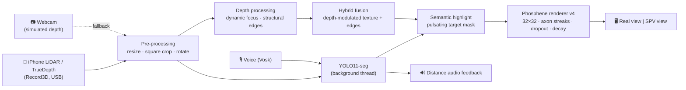

1. **Acquisition** – synchronized RGB + depth from Record3D, or webcam with `MockLiDARStream`.
2. **Pre-processing** – resize to 640 px, 1:1 crop, rotation.
3. **Detection** – YOLO11n-seg in a dedicated thread (non-blocking; MPS / CUDA / CPU auto-selected).
4. **Depth processing** – smoothed focus distance from a central ROI; structural edges via a spatially adaptive algorithm (rear LiDAR) or erosion + bilateral filter + Canny (FaceID).
5. **Fusion** – grayscale texture modulated by proximity, with depth edges overlaid at full intensity.
6. **Semantic highlight** – the selected target's mask pulsates at a fixed frequency.
7. **Rendering** – phosphene simulation and side-by-side display.

See [`docs/debug_views.md`](docs/debug_views.md) for the debug views and rendering modes.

## Results

Online study, **89 participants** (≈75% aged 18–25), comparing **Hybrid** (proposed) vs **RGB-only** (baseline) rendering on recorded scenes.

### Survey stimuli

Participants watched short phosphene animations generated by the pipeline. In the comparison tests, the **left** half is the **RGB-only** baseline (Mode 1) and the **right** half is the **depth-aware hybrid** rendering (Mode 2).

**Test A – Target identification.** The YOLO-segmented target pulsates inside the phosphene field: can users notice it and name it?

<p align="center">
  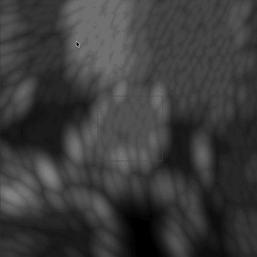
  &nbsp;
  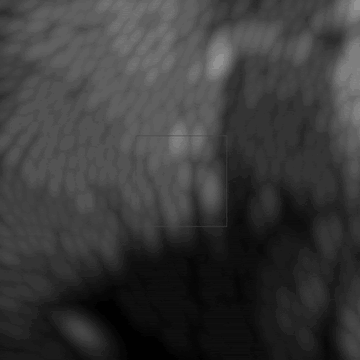
  <br/><sub>Laptop (left) · Bottle (right)</sub>
</p>

**Test B – Static scenes.** Which mode conveys geometry and obstacle borders better? (RGB-only left · Hybrid right)

| Chair (geometry) | Bed (obstacles) | Door (contrast) |
|:---:|:---:|:---:|
| 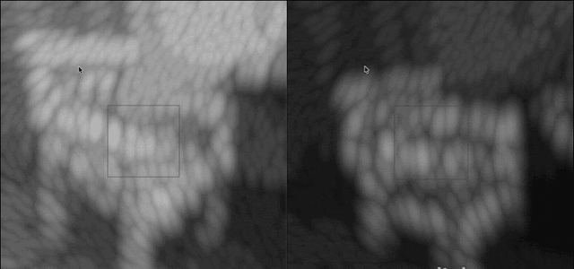 | 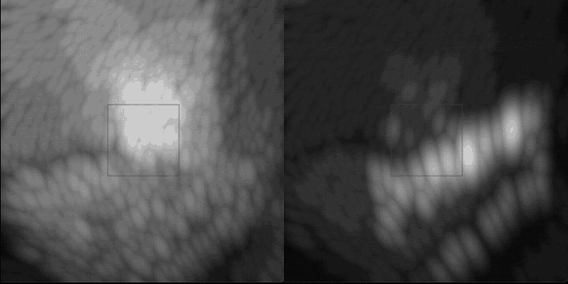 | 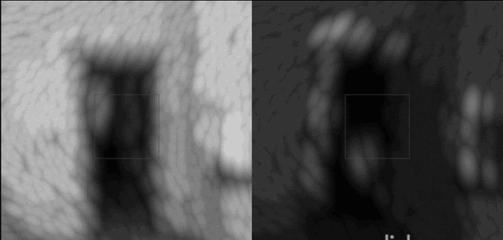 |

**Test C – Navigation.** Using only the overall brightness change of the grid, is the user approaching, moving away or standing still?

<p align="center">
  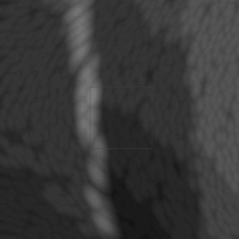
</p>

**Test D – Moving subject.** Which mode tracks a walking person best? (shown at the top of this page)

### Outcomes

| Test | Hybrid | RGB-only |
|---|---|---|
| Moving subject tracking | **79.8%** | 19.1% |
| Static geometry (chair) | **63%** | 31% |
| Obstacle detection (bed) | **51%** | 35% |
| High-contrast detail (door) | 27% | **64%** |

| Semantic target | Detection | Identification |
|---|---|---|
| Laptop | 71% | 40.5% |
| Bottle | 57% | 51% |

<p align="center">
  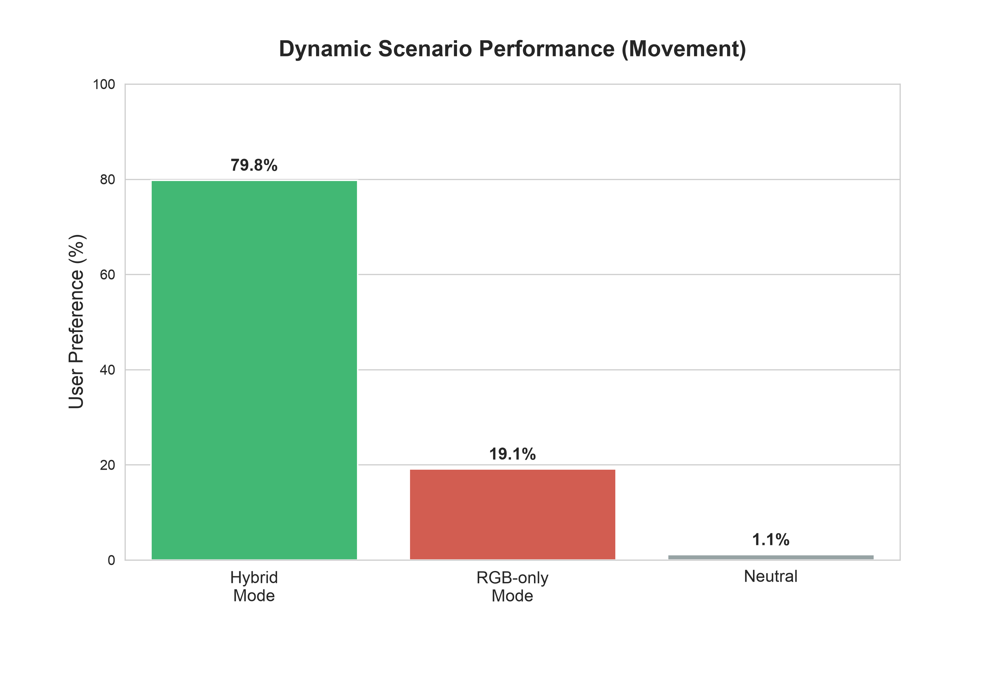
  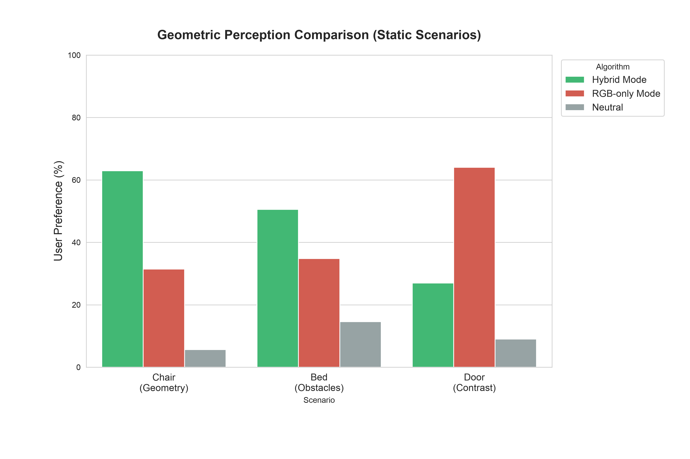
  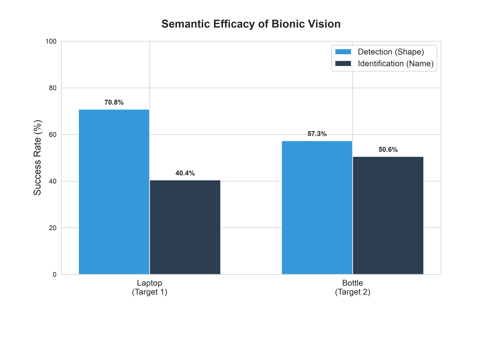
  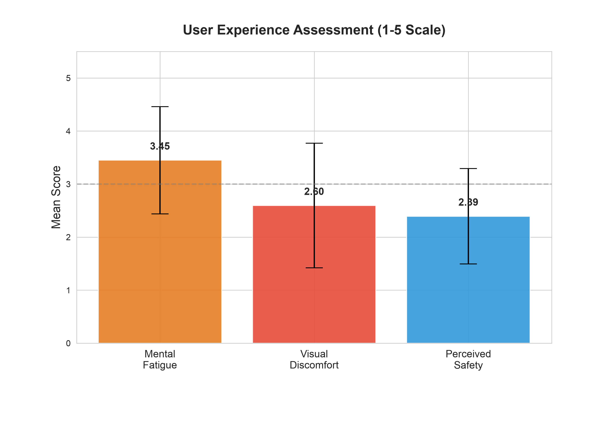
</p>

**Takeaway:** depth-aware edges remove flicker and ghosting, which strongly improves dynamic scenes; RGB-only preserves fine texture in static low-contrast scenes, pointing to an adaptive filter as future work. Full discussion in [`results/results_summary.md`](results/results_summary.md) and in the [presentation](docs/presentation.pdf).

## Getting Started

### Requirements

- Python **3.10 – 3.12**
- macOS (Apple Silicon recommended, MPS acceleration), Linux or Windows (CUDA optional)
- *Optional:* iPhone 12 Pro or later with the [Record3D](https://record3d.app/) app (USB streaming), a microphone for voice control

### Installation

```bash
git clone https://github.com/migalella/depth-aware-prosthetic-vision.git
cd depth-aware-prosthetic-vision

python3 -m venv .venv
source .venv/bin/activate

# macOS only: PortAudio is required by pyaudio
brew install portaudio

pip install -r requirements.txt

# Vosk speech model for voice control (~40 MB, saved to ./model)
bash scripts/download_vosk_model.sh
```

The YOLO11 weights (`yolo11n-seg.pt`) are downloaded automatically by Ultralytics on the first run.

### Run

```bash
python vision_project.py
```

- **LiDAR mode:** connect the iPhone via USB, open Record3D and enable USB streaming *before* launching. The sensor (rear LiDAR or FaceID) is detected automatically.
- **Webcam mode:** if no Record3D stream is found, the default webcam is used with simulated depth (depth-based brightness, edges and audio distance are not meaningful in this mode).

### Reproduce the study analysis

```bash
pip install -r requirements-analysis.txt
python analysis/form_analysis.py   # regenerates the figures in results/
```

## Controls

| Key | Action |
|---|---|
| `q` | Quit |
| `d` | Toggle object detection |
| `a` | Show all detected classes / target only |
| `t` | Cycle target (Cup, Bottle, iPhone, Laptop, Chair, Remote, Book, Person, Fork, Spoon) |
| `r` | Switch phosphene renderer (v4 → v3 → v2) |
| `v` | Show SPV view only |
| `g` | Pure RGB mode (no depth) |
| `p` | Pure depth mode (no RGB texture) |
| `o` | Toggle distance audio feedback |
| `s` | Show the renderer's input saliency map (debug) |

**Voice:** say **"Jarvis"** (a beep confirms), then a target name (*"cup"*, *"person"*, ...), *"stop"* / *"start"* for detection or *"audio"* to toggle audio feedback. The system default microphone is used; to pick another input, set `device_index` in `vision_project.py`.

## Project Structure

```
depth-aware-prosthetic-vision/
├── vision_project.py            # Main application: acquisition, fusion, UI loop
├── iphone_lidar.py              # Record3D LiDAR/TrueDepth stream + webcam mock
├── phosphene_processing_v4.py   # Final renderer (axon streaks, dropout, decay, LUT)
├── phosphene_processing_v3.py   # Renderer with temporal adaptation
├── phosphene_processing_v2.py   # Renderer with axon map + temporal noise
├── voice_control.py             # Vosk wake-word voice command system
├── scripts/
│   └── download_vosk_model.sh   # Fetches the Vosk model into ./model
├── analysis/
│   └── form_analysis.py         # User-study statistics and figures
├── data/
│   └── survey_responses.csv     # Anonymized questionnaire answers (Italian)
├── results/                     # Figures + results summary
├── docs/                        # Presentation, technical notes, survey GIFs (media/survey)
├── requirements.txt
└── requirements-analysis.txt
```

## Team

| Name | Contact |
|---|---|
| **Michele Ivo Galella** | [@migalella](https://github.com/migalella) |
| **Simona Frascella** | [@sfrascella](https://github.com/sfrascella) |
| **Edoardo Capobianco** | |

## Acknowledgements

Developed for the **Bionic Senses** course (M.Sc. in Neural Engineering, Scuola Superiore Sant'Anna & University of Pisa). Built on [Ultralytics YOLO](https://github.com/ultralytics/ultralytics), [Record3D](https://github.com/marek-simonik/record3d), [Vosk](https://alphacephei.com/vosk/) and [OpenCV](https://opencv.org/). The phosphene model draws on the simulated prosthetic vision literature (e.g. axon-map models of epiretinal stimulation).

## Citation

If you use this work, please cite it via the [`CITATION.cff`](CITATION.cff) file (GitHub: *"Cite this repository"*).

## License

Released under the [MIT License](LICENSE).
